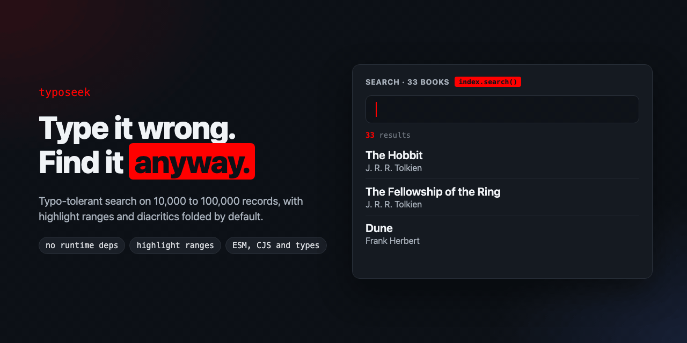

# typoseek



[](https://www.npmjs.com/package/typoseek)
[](https://github.com/d2a8k3u/typoseek/actions/workflows/ci.yml)
[](https://bundlejs.com/?q=typoseek)
[](https://www.npmjs.com/package/typoseek)
[](https://github.com/d2a8k3u/typoseek/blob/main/LICENSE)
[](https://github.com/d2a8k3u/typoseek/actions/workflows/pages.yml)

Typo-tolerant search on 10,000 to 100,000 records in the browser or in Node, with a [capped cost](https://github.com/d2a8k3u/typoseek/blob/main/docs/options.md#limits) per query, highlight ranges for every hit and diacritics folded by default: `barclona` finds `Barcelona`, `lodz` finds `Łódź`. No runtime dependencies and no Node built-ins.

Try it in the [live demo](https://d2a8k3u.github.io/typoseek/).

- Typo tolerance by edit distance, prefix and infix matching on the last query term, diacritic folding.
- Weighted keys, filters, sorting, pagination, phrases and negation.
- An index you can add to, update and remove from, and save as a snapshot that a worker loads.
- Ships ESM and CommonJS with types. Needs Node 22 or newer when run on Node.

## Compared with other libraries

|                                                   | typoseek                              | MiniSearch                  | Fuse                        | Orama                          | fuzzysort        | uFuzzy                              |
| ------------------------------------------------- | ------------------------------------- | --------------------------- | --------------------------- | ------------------------------ | ---------------- | ----------------------------------- |
| Typos                                             | up to 2 edits per word, on by default | edit distance with `fuzzy`  | on by default (`threshold`) | edit distance with `tolerance` | no edit distance | 1 edit per word with `intraMode: 1` |
| Scans every record on each search                 | no                                    | no                          | yes                         | no                             | yes              | yes                                 |
| Highlight ranges                                  | yes                                   | no, matched terms per field | with `includeMatches`       | no                             | yes              | yes                                 |
| Diacritics folded                                 | by default                            | with a custom `processTerm` | with `ignoreDiacritics`     | one `language` per index       | by default       | with `uFuzzy.latinize()`            |
| Field weights                                     | yes                                   | `boost`                     | key `weight`                | `boost`                        | no               | no fields, plain strings            |
| Add, update, remove                               | yes                                   | yes                         | add and remove              | yes                            | no index         | no index                            |
| gzip size                                         | 13.3 kB                               | 5.88 kB                     | 9.63 kB                     | 25.3 kB                        | 8.46 kB          | 4.28 kB                             |
| Search p95, 10,000 records                        | 7.48 ms                               | 2.29 ms                     | 150.29 ms                   | 58.24 ms                       | 4.31 ms          | 7.32 ms                             |
| Search p95, 100,000 records                       | 28.89 ms                              | 28.93 ms                    | 1,505.01 ms                 | 5,141.67 ms                    | 61.41 ms         | 66.62 ms                            |
| Queries with at least one hit, of 200, at 100,000 | 186                                   | 165                         | 188                         | 143                            | 53               | 91                                  |

Versions are MiniSearch 7.2.0, Fuse 7.5.0, Orama 3.1.18, fuzzysort 4.0.2 and uFuzzy 1.0.19. Sizes are from bundlejs on 2026-11-27. Timings and hit counts are from one run of `npm run bench` on an Apple M4 Pro, each library set as close to typoseek's defaults as it allows. At 10,000 records MiniSearch, fuzzysort and uFuzzy answer faster, and typoseek is the second largest bundle. It also builds slower and holds more heap than the benchmark median. [BENCHMARK.md](https://github.com/d2a8k3u/typoseek/blob/main/BENCHMARK.md) has the machine, the dataset, build times, heap and how to rerun it.

Coming from Fuse, MiniSearch or match-sorter? [Migration](https://github.com/d2a8k3u/typoseek/blob/main/docs/migration.md) runs the same query through both libraries.

## Install

```bash
npm install typoseek
```

The package has three entry points: `typoseek` (search and index), `typoseek/serialize` (`loadIndex`) and `typoseek/segmenter` (`createSegmenterTokenizer`).

## Quick start

One-shot search over an array. `refIndex` is the item's position in the array, `matches` holds the highlight ranges:

```ts
import { search } from 'typoseek';

const cities = ['Amsterdam', 'Barcelona', 'Copenhagen', 'Dublin'];

const { total, hits } = search(cities, 'barclona');

console.log(total);
for (const hit of hits) {
  console.log(hit.refIndex, hit.item, JSON.stringify(hit.matches));
}
```

```text
1
1 Barcelona [{"key":"","valueIndex":0,"ranges":[[0,9]]}]
```

An index for records you search repeatedly and change over time. `createIndex` needs the record type as a type argument, so a misspelled key does not compile:

```ts
import { createIndex } from 'typoseek';

interface Book {
  id: number;
  title: string;
  author: string;
}

const index = createIndex<Book>({ idKey: 'id', keys: [{ path: 'title', weight: 2 }, 'author'] });

index.addAll([
  { id: 1, title: 'The Fellowship of the Ring', author: 'J. R. R. Tolkien' },
  { id: 2, title: 'The Hobbit', author: 'J. R. R. Tolkien' },
  { id: 3, title: 'Dune', author: 'Frank Herbert' },
]);

const { total, hits } = index.search('tolkein hobit');
console.log(total, hits.map((hit) => hit.id).join(','));
console.log(JSON.stringify(hits[0]?.matches));

index.update({ id: 3, title: 'Dune Messiah', author: 'Frank Herbert' });
index.remove(1);
console.log(index.size, index.has(1), index.search('messiah').total);
```

```text
1 2
[{"key":"title","valueIndex":0,"ranges":[[4,10]]},{"key":"author","valueIndex":0,"ranges":[[9,16]]}]
2 false 1
```

`search(items, query, { keys })` also takes an array of objects. Without `keys`, every item must be a string.

## Accents in any language

Terms are compared with case and diacritics folded, so a query typed without accents finds accented text, typos included. Letters that do not decompose, such as `ł`, `ø`, `ß` and `æ`, are mapped as well, and one index holds every language without a language setting. The ranges point into the original string:

```ts
import { search } from 'typoseek';

const places = ['Łódź', 'Tromsø', 'São Paulo', 'Hradec Králové'];

for (const query of ['lodz', 'tromso', 'sao paolo', 'kralove']) {
  const { hits } = search(places, query);
  console.log(query, JSON.stringify(hits.map((hit) => hit.item)), JSON.stringify(hits[0]?.matches[0]?.ranges));
}
```

```text
lodz ["Łódź"] [[0,4]]
tromso ["Tromsø"] [[0,6]]
sao paolo ["São Paulo"] [[0,3],[4,9]]
kralove ["Hradec Králové"] [[7,14]]
```

Japanese, Chinese, Thai and other languages written without spaces need the [segmenter tokenizer](https://github.com/d2a8k3u/typoseek/blob/main/docs/pipeline.md#segmenter).

## Documentation

- [Options](https://github.com/d2a8k3u/typoseek/blob/main/docs/options.md): index, search and load options, and the caps on queries.
- [Query syntax and ranking](https://github.com/d2a8k3u/typoseek/blob/main/docs/query-and-ranking.md): phrases, negation, prefix and infix rules, the ranking order and how terms are folded.
- [Errors](https://github.com/d2a8k3u/typoseek/blob/main/docs/errors.md): every error code and what a rejected call leaves in the index.
- [Indexed records and serialization](https://github.com/d2a8k3u/typoseek/blob/main/docs/serialization.md): snapshots, `loadIndex` and a worker recipe.
- [Segmenter and custom pipeline](https://github.com/d2a8k3u/typoseek/blob/main/docs/pipeline.md): `Intl.Segmenter` tokenizing and your own tokenizer, normalizer and stemmer.
- [Migration](https://github.com/d2a8k3u/typoseek/blob/main/docs/migration.md): from Fuse, MiniSearch and match-sorter.
- [API reference](https://github.com/d2a8k3u/typoseek/blob/main/docs/api.md): every export, by entry point.
- [Benchmark](https://github.com/d2a8k3u/typoseek/blob/main/BENCHMARK.md): every library, its settings and how to rerun it.
